# Mockup and wireframes of Story Shelf

## Contents

- [Mockup](#mockup)
  - [01 Start](#screen-01)
  - [02 Log in](#screen-02)
  - [03 Sign up](#screen-03)
  - [04 Reset Password](#screen-04)
  - [05 Home](#screen-05)
  - [06 Library](#screen-06)
  - [07 Story Search](#screen-07)
  - [08 Add Story (from search)](#screen-08)
  - [09 Add Story (manual)](#screen-09)
  - [10 Story Details](#screen-10)
  - [11 Edit Story](#screen-11)
  - [12 Add Memory](#screen-12)
  - [13 Memory Details (view, edit and mood)](#screen-13)
  - [14 Memories](#screen-14)
  - [15 Profile](#screen-15)
  - [16 Settings](#screen-16)
  - [17 Edit Profile](#screen-17)
- [Screen flow](#screen-flow)
- [Wireframes](#wireframes)

## Mockup

17 screens, in app order. The tab bar is Home, Library, Memories, Profile.

| Screen | Screen Details |
|---|---|
| <a id="screen-01"></a>**01 Start**<br><br>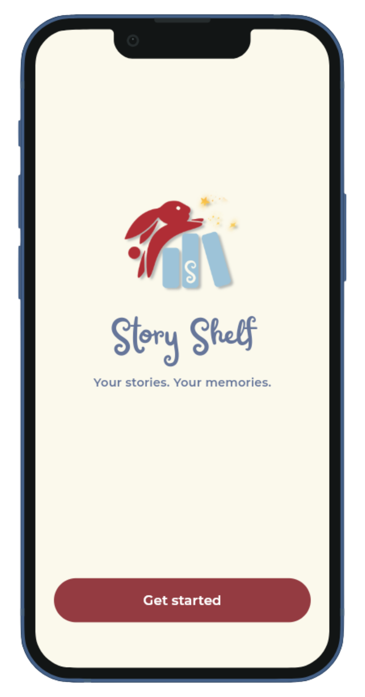 | **Purpose**<br>The Start screen introduces Story Shelf to signed-out users with the app name and tagline, "Your stories. Your memories."<br><br>**User Actions and Flow**<br>• "Get started" button: Navigates to the Log in screen.<br><br>**Navigation**<br>First screen when the app opens and no one is signed in. Signed-in users skip it and land on Home. |
| <a id="screen-02"></a>**02 Log in**<br><br>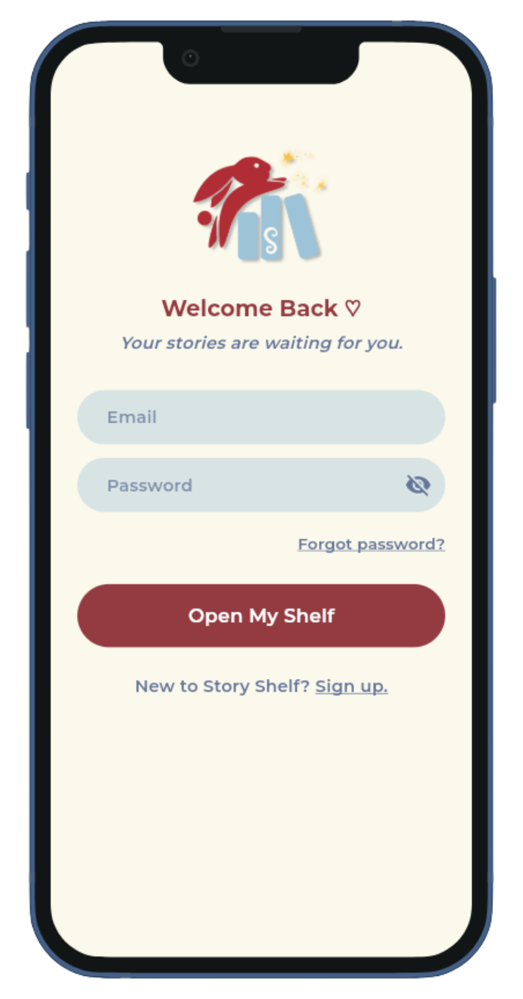 | **Purpose**<br>Lets existing users access their Story Shelf account with their email or username and password.<br><br>**User Actions and Flow**<br>• Email / username field: Enter the email or username for the account.<br>• Password field with eye icon: Enter the password; the eye shows or hides it.<br>• "Forgot password?" link: Navigates to Reset Password.<br>• "Open My Shelf" button: Signs in and navigates to Home.<br>• "Sign up." link: Navigates to Sign up.<br><br>**Navigation**<br>Reached from Start. From here users continue to Home, recover their account, or create one. |
| <a id="screen-03"></a>**03 Sign up**<br><br>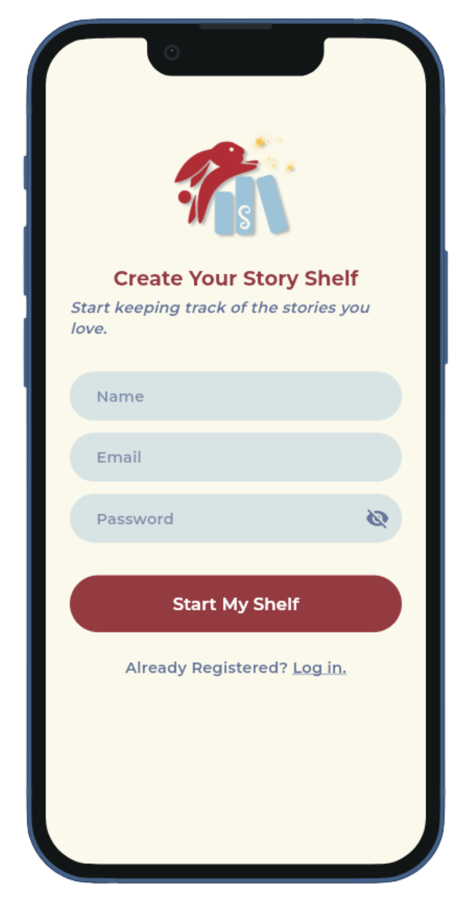 | **Purpose**<br>Lets new users create a Story Shelf account.<br><br>**User Actions and Flow**<br>• Name field: Enter a display name.<br>• Email field: Enter a valid email address.<br>• Password field with eye icon: Create a password of at least 6 characters; the eye shows or hides it.<br>• "Start My Shelf" button: Creates the account and shows a message to check the email to confirm.<br>• "Log in." link: Returns to Log in for users who already have an account.<br><br>**Navigation**<br>Reached from the "Sign up." link on Log in. |
| <a id="screen-04"></a>**04 Reset Password**<br><br>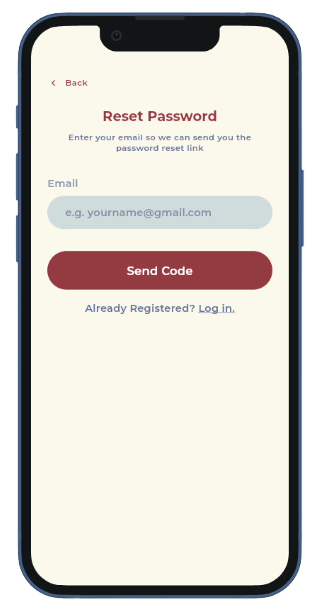 | **Purpose**<br>Lets users who cannot sign in request a password reset link for the email on their account.<br><br>**User Actions and Flow**<br>• Email field: Enter the email address for the account.<br>• "Send Code" button: Sends the reset email and confirms with "Check your email for a reset link."<br>• "Log in." link and Back button: Return to Log in.<br><br>**Navigation**<br>Reached from the "Forgot password?" link on Log in. |
| <a id="screen-05"></a>**05 Home**<br><br>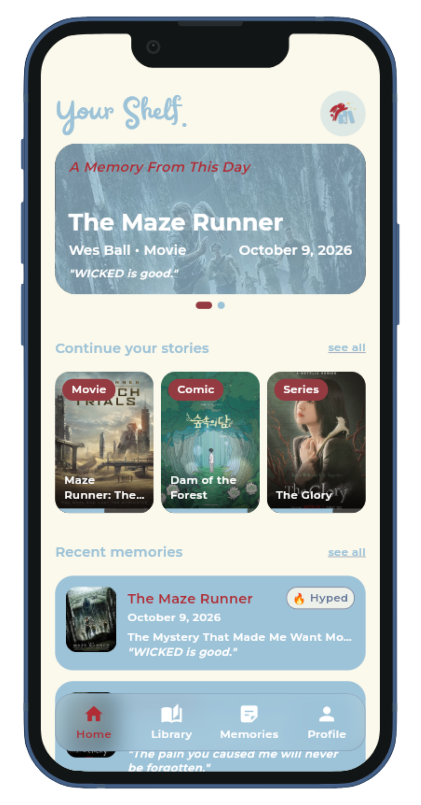 | **Purpose**<br>A personal overview of the shelf: a featured memory, stories in progress, and recent memories.<br><br>**User Actions and Flow**<br>• "A Memory From This Day" banner: Shows a memory picked for today; tapping it opens that memory's Memory Details.<br>• "Continue your stories" grid: Each card shows a story in progress; tapping opens Story Details. "See all" opens Library.<br>• "Recent memories" list: Each card shows a memory; tapping opens Memory Details. "See all" opens Memories.<br>• Empty states: "Your shelf is empty" and "No memories yet" guide new users.<br>• Bottom navigation bar: Switches between Home / Library / Memories / Profile with a page-flip animation.<br><br>**Navigation**<br>The main landing screen after signing in, and the first tab. |
| <a id="screen-06"></a>**06 Library**<br><br>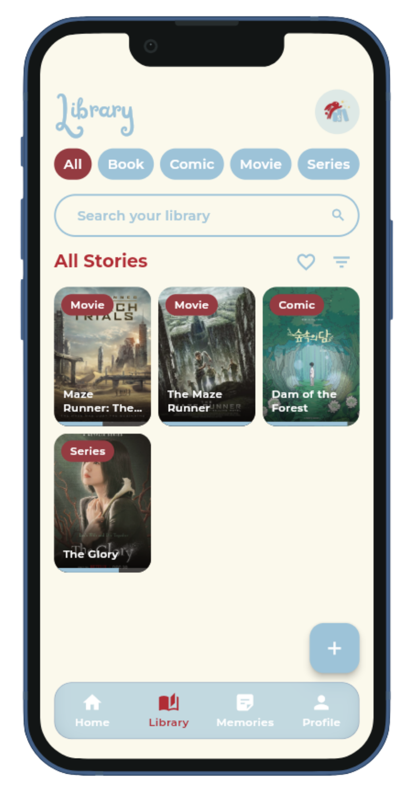<br><br>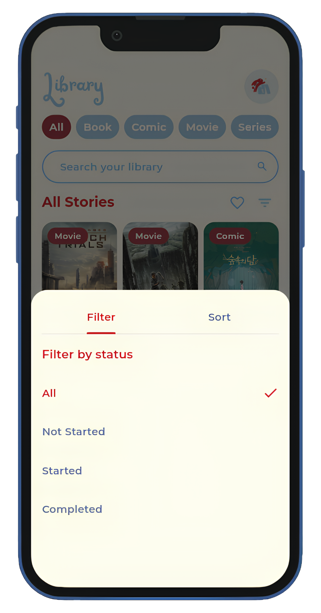 | **Purpose**<br>Shows every story on the shelf and is the main place to find, filter and manage them.<br><br>**User Actions and Flow**<br>• Search bar: Finds stories by title or keyword.<br>• Medium chips (scrollable): Switch between All, Book, Comic, Movie and Series.<br>• Heart button: Shows favorited stories only. It combines with the medium, status and search filters.<br>• Filter and sort button: Opens a bottom sheet with two tabs. Filter chooses a status (All / Not Started / Started / Completed); Sort chooses Alphabetical (A-Z) or Latest read.<br>• Story poster cards: Navigate to that story's Story Details.<br>• "+" button: Navigates to Story Search to add a story.<br>• Bottom navigation bar: Switches between the four main tabs.<br><br>**Navigation**<br>Reached from the Library tab or "See all" on Home. It is the starting point for adding stories. |
| <a id="screen-07"></a>**07 Story Search**<br><br>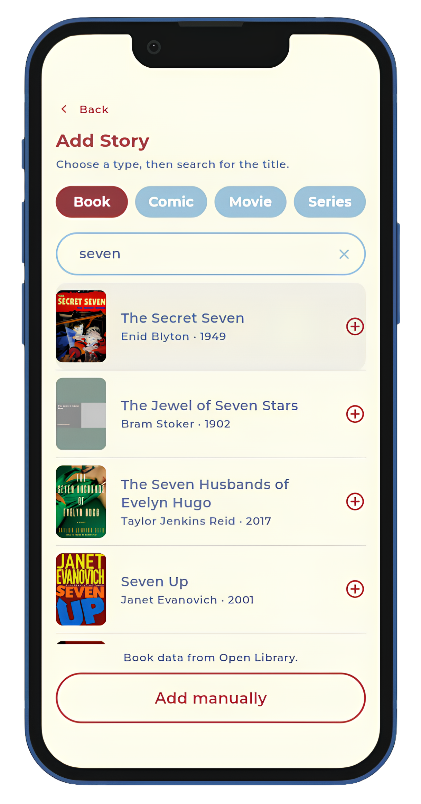 | **Purpose**<br>The first step of adding a story. The user searches for it by title so the details can be filled in automatically.<br><br>**User Actions and Flow**<br>• Type chips: Choose Book, Comic, Movie or Series before searching.<br>• Search field: Search by title. Results show the cover, title, creator and year.<br>• Result row: Tapping a result fetches its details and opens Add Story with the form already filled in (screen 08). A story that is already on the shelf shows an "On your shelf" badge and opens its Story Details instead.<br>• Source note: Shows where the data comes from (Open Library for books, AniList for comics, TMDB for movies and series).<br>• "Add manually" button (and "Can't find it? Add manually" under the results): Opens a blank Add Story form (screen 09).<br>• Back button: Returns to Library without adding anything.<br><br>**Navigation**<br>Reached from the "+" button on Library. It leads to Add Story either prefilled or blank. |
| <a id="screen-08"></a>**08 Add Story (from search)**<br><br>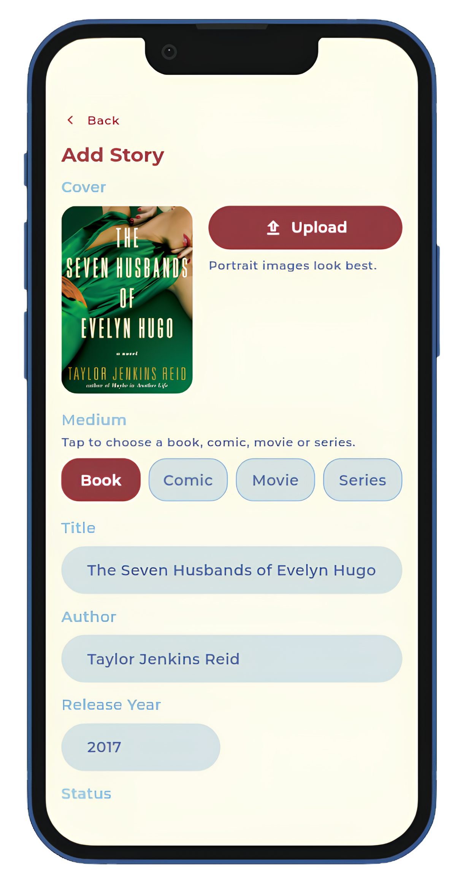 | **Purpose**<br>Saves a story found through search. The form opens with the details already filled in so the user only needs to review and finish it.<br><br>**User Actions and Flow**<br>• Cover: Filled from the search result; Upload lets the user replace it with a photo or a web link.<br>• Medium chips, Title, Creator (Author, Director, etc.) and Release Year: Prefilled and still editable.<br>• Status selector: Not Started, Started or Completed.<br>• Progress fields (Current and Total pages, chapters or episodes): Shown for books, comics and series.<br>• Rating: Star rating out of five.<br>• "Save Story" button: Saves the story and opens its Story Details.<br>• Back button: Returns to Story Search.<br><br>**Navigation**<br>Reached by tapping a result on Story Search. |
| <a id="screen-09"></a>**09 Add Story (manual)**<br><br>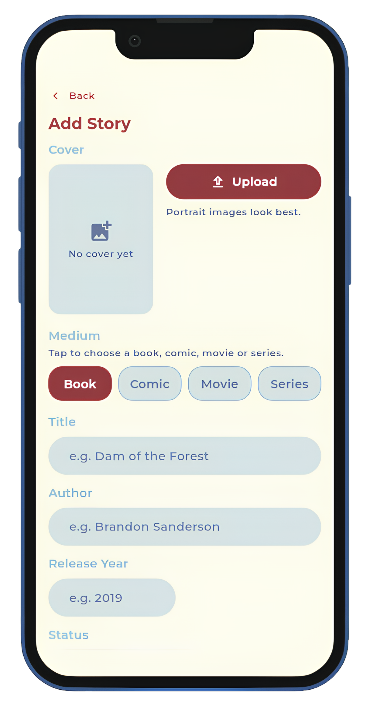 | **Purpose**<br>Lets the user add a story by hand when it cannot be found through search.<br><br>**User Actions and Flow**<br>• Same form as screen 08, but every field starts empty.<br>• Cover, Medium, Title, Creator, Release Year, Status, Progress and Rating are all filled in by the user.<br>• "Save Story" button: Saves the story and opens its Story Details.<br>• Back button: Returns to Story Search.<br><br>**Navigation**<br>Reached from "Add manually" on Story Search. |
| <a id="screen-10"></a>**10 Story Details**<br><br>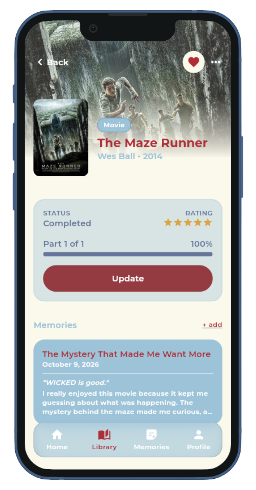 | **Purpose**<br>A complete view of one story, and the hub for the memories written about it.<br><br>**User Actions and Flow**<br>• Header (cover, medium, title, creator, release year): Static display, with a favorite (heart) toggle.<br>• Status, Rating and Progress block: Status reads Not Started, Currently Reading or Currently Watching, or Completed. The "Update" button opens Edit Story.<br>• Memories list: Each memory card opens its Memory Details; an empty state reads "No memories yet".<br>• "+ add" button: Opens Add Memory for this story.<br>• "More" menu: Delete story, with a confirmation dialog.<br>• Back button: Returns to the previous screen.<br><br>**Navigation**<br>Reached from story cards on Home, Library and the existing-story result in Story Search. All memory actions branch from here. |
| <a id="screen-11"></a>**11 Edit Story**<br><br>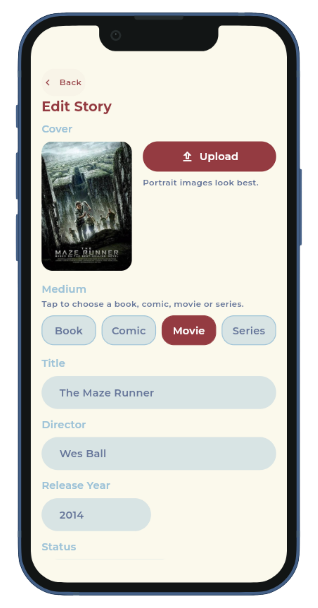 | **Purpose**<br>Changes an existing story without creating a new entry.<br><br>**User Actions and Flow**<br>• All fields (cover, medium, title, creator, release year, status, progress, rating): Prefilled and editable.<br>• Save button: Saves the changes and returns to Story Details with the new information.<br>• Back button: Returns without saving.<br><br>**Navigation**<br>Reached from the Update button on Story Details. |
| <a id="screen-12"></a>**12 Add Memory**<br><br>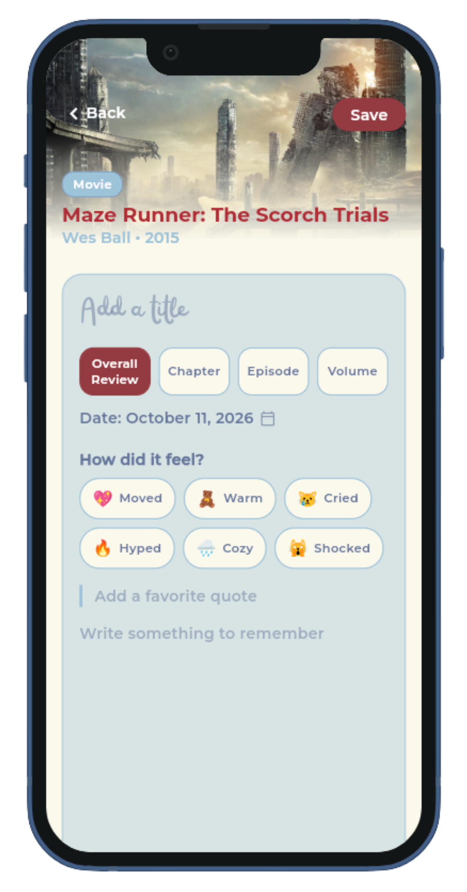 | **Purpose**<br>Records a personal reaction, thought or reflection about a story.<br><br>**User Actions and Flow**<br>• Title field: Optional title for the memory.<br>• Entry type chips: Overall Review, Chapter, Episode or Volume. The last three reveal a number field.<br>• Date: Choose when the memory was written.<br>• "How did it feel?": Pick a mood (Moved, Warm, Cried, Hyped, Cozy or Shocked).<br>• Favorite quote field: Optional quote to keep.<br>• "Write something to remember" field: The memory text, which is required.<br>• Save button: Saves the memory.<br>• Back button: If something is typed, asks "Discard this memory?" with Keep writing or Discard.<br><br>**Navigation**<br>Reached from "+ add" on Story Details. The memory is attached to that story automatically. |
| <a id="screen-13"></a>**13 Memory Details (view, edit and mood)**<br><br>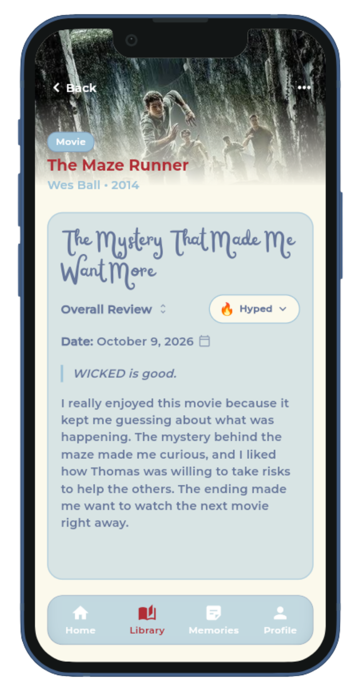<br><br>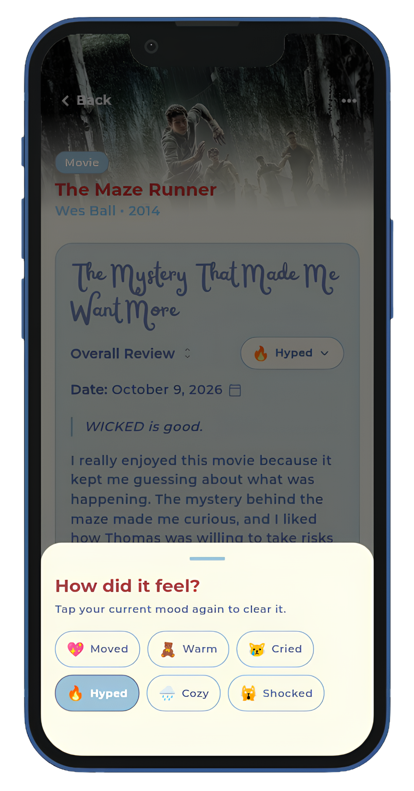 | **Purpose**<br>Shows one memory in full and lets the user edit it in place. Editing no longer needs a separate screen.<br><br>**User Actions and Flow**<br>• Header (story title, medium and creator): Shows which story the memory belongs to.<br>• Title, entry type, number, date, favorite quote and note: Tap any of them to edit directly. Changes save automatically, with a Saving / Saved / Not saved indicator. An empty note is rejected and the last saved version is kept.<br>• Entry type: Opens an "Entry type" sheet with a Done button.<br>• Mood chip: Opens the "How did it feel?" sheet to set or change the mood.<br>• "More" menu: Delete memory, with a confirmation dialog.<br>• Back button: Returns to the previous screen.<br><br>**Navigation**<br>Reached from Memories, Home's Recent memories and a story's memory list. It replaces the separate Edit Memory screen from the earlier mockup. |
| <a id="screen-14"></a>**14 Memories**<br><br>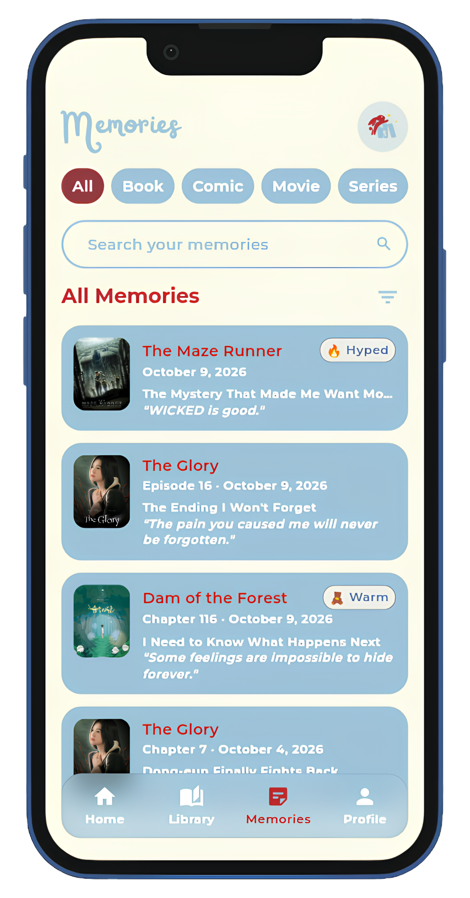<br><br>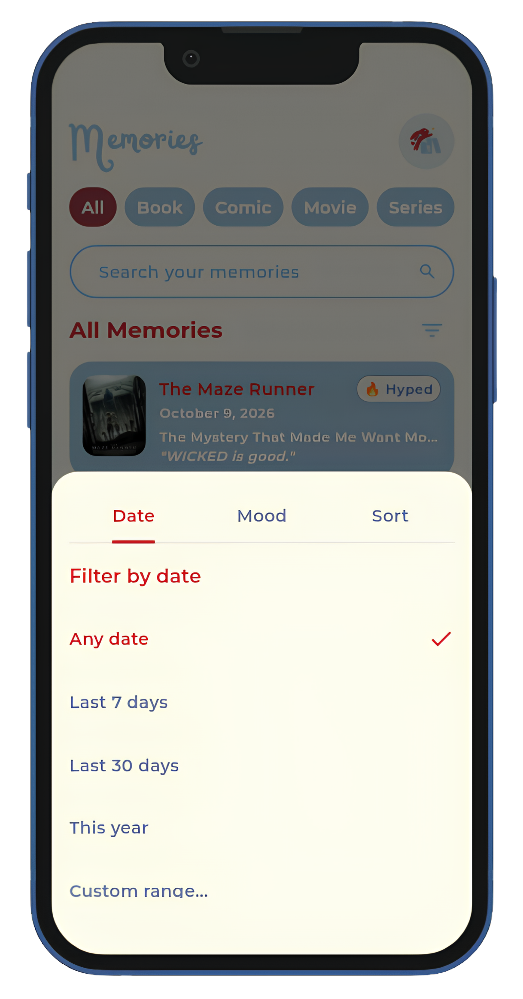 | **Purpose**<br>Lists every memory across all stories in one place. It replaces the Search tab from the earlier mockup.<br><br>**User Actions and Flow**<br>• Memory cards: Each shows the story, title, type, date, mood and an excerpt; tapping opens Memory Details.<br>• Search bar: Finds memories by keyword.<br>• Filter and sort button: Opens a bottom sheet with three tabs. Date offers Any date, Last 7 days, Last 30 days, This year or a custom range; Mood offers Any mood or one mood; Sort offers Newest first or Oldest first.<br>• Bottom navigation bar: Switches between the four main tabs.<br><br>**Navigation**<br>Reached from the Memories tab or "See all" on Home's Recent memories. |
| <a id="screen-15"></a>**15 Profile**<br><br>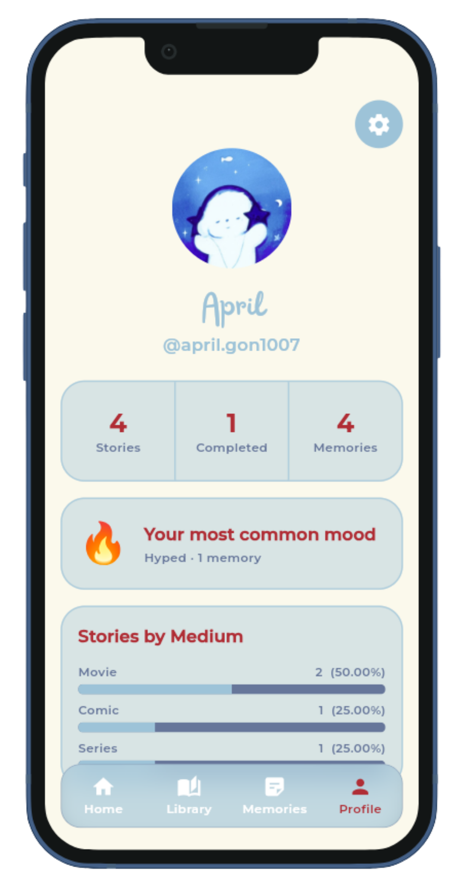 | **Purpose**<br>An overview of the user's account and reading and watching activity.<br><br>**User Actions and Flow**<br>• Photo, name and @username: Static display. The photo stays empty until the user adds one.<br>• Stats card: Total Stories, Completed and Memories.<br>• "Your most common mood" card: Shows the mood used most across memories.<br>• "Stories by Medium" card: A breakdown with counts and percentages.<br>• Settings button: Opens Settings.<br>• Bottom navigation bar: Switches between the four main tabs.<br><br>**Navigation**<br>Reached from the Profile tab. |
| <a id="screen-16"></a>**16 Settings**<br><br>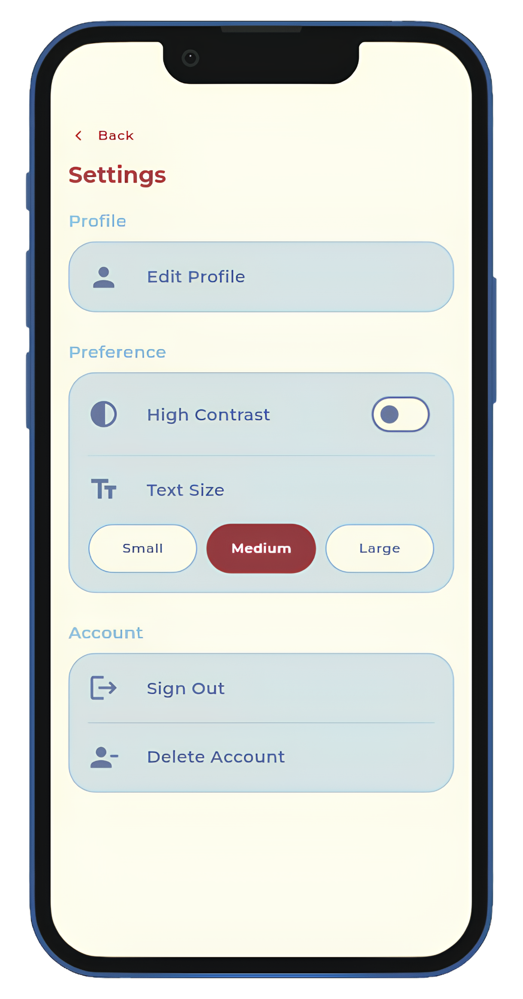 | **Purpose**<br>Manages the profile, how the app looks, and the account.<br><br>**User Actions and Flow**<br>• Edit Profile row: Opens Edit Profile.<br>• High Contrast toggle: Switches to a higher-contrast look.<br>• Text Size: Choose a text size; both appearance settings are saved to the account.<br>• Sign Out row: Confirms with "Sign out?", then returns to Start.<br>• Delete Account row: Confirms with "Delete account?" and permanently deletes the account, stories and memories.<br><br>**Navigation**<br>Reached from the Settings button on Profile. |
| <a id="screen-17"></a>**17 Edit Profile**<br><br>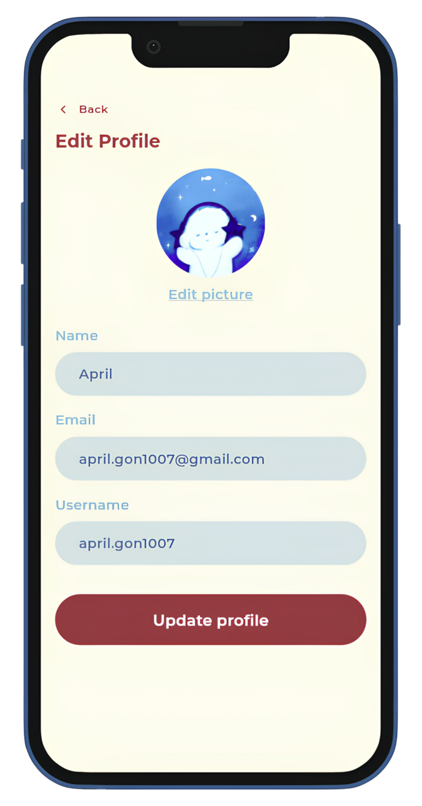 | **Purpose**<br>Updates the personal information shown on the profile.<br><br>**User Actions and Flow**<br>• Profile photo: Choose from the gallery or remove it.<br>• Name, Email and Username fields: Prefilled and editable.<br>• "Update profile" button: Saves and returns with the new information.<br>• Back button: Returns without saving.<br><br>**Navigation**<br>Reached from the Edit Profile row in Settings. |

## Screen flow

The main journey: sign in, add a story to the shelf, write a memory about it, and look back on it. Click any screen to jump to its details above.

| | | | | |
|:-:|:-:|:-:|:-:|:-:|
| <a href="#screen-01"></a><br><b>01 Start →</b> | <a href="#screen-02"></a><br><b>02 Log in →</b> | <a href="#screen-05"></a><br><b>05 Home →</b> | <a href="#screen-06"></a><br><b>06 Library →</b> | <a href="#screen-07"></a><br><b>07 Story Search →</b> |
| <a href="#screen-08"></a><br><b>08 Add Story →</b> | <a href="#screen-10"></a><br><b>10 Story Details →</b> | <a href="#screen-12"></a><br><b>12 Add Memory →</b> | <a href="#screen-13"></a><br><b>13 Memory Details →</b> | <a href="#screen-14"></a><br><b>14 Memories</b> |

### How the screens connect

```
Start -> Log in -> Home
          |  |
          |  +-> Reset Password
          +----> Sign up

Home / Library / Memories / Profile   (navigation bar)

Library -> "+" -> Story Search
                    |
                    |-> tap a result  -> Add Story (prefilled) -> Story Details
                    |
                    +-> Add manually  -> Add Story (blank)     -> Story Details

Home / Library -> Story Details -> Edit Story
                               |
                               +-> Add Memory -> (saves)
    
Home / Memories -> Memory Details (view, edit, mood)

Profile -> Settings -> Edit Profile
                   |
                   +-> Sign Out -> Start
```

## Wireframes

The plan for the app. Each box is a screen and each label is the tap that leads to the next one. From Home, the user branches into Library (add a story, then write a memory), Memories, and Profile.

<p align="center">
  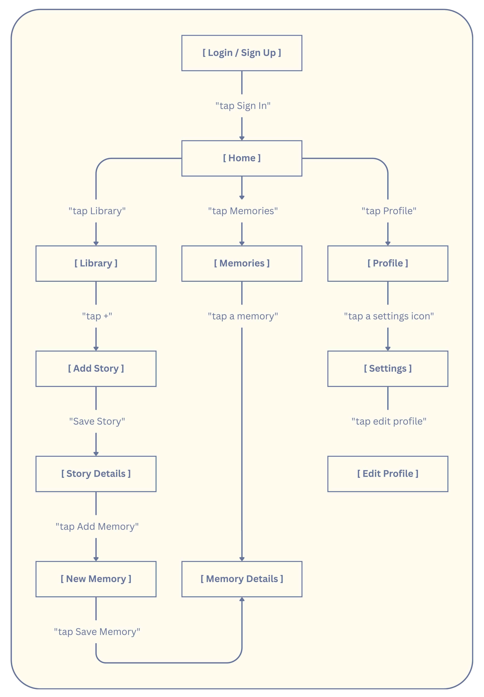
</p>
